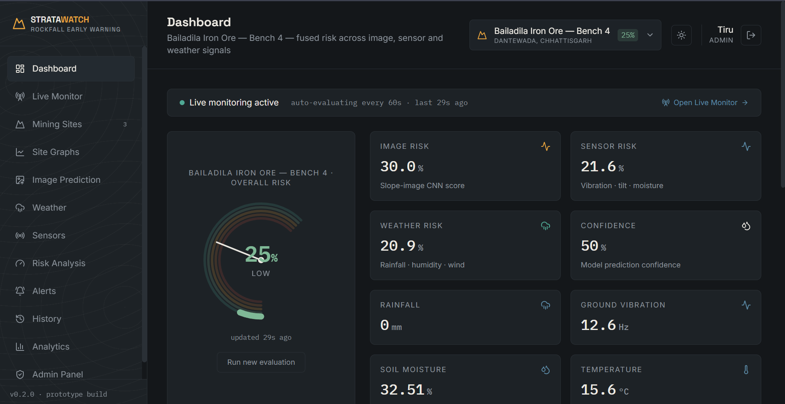
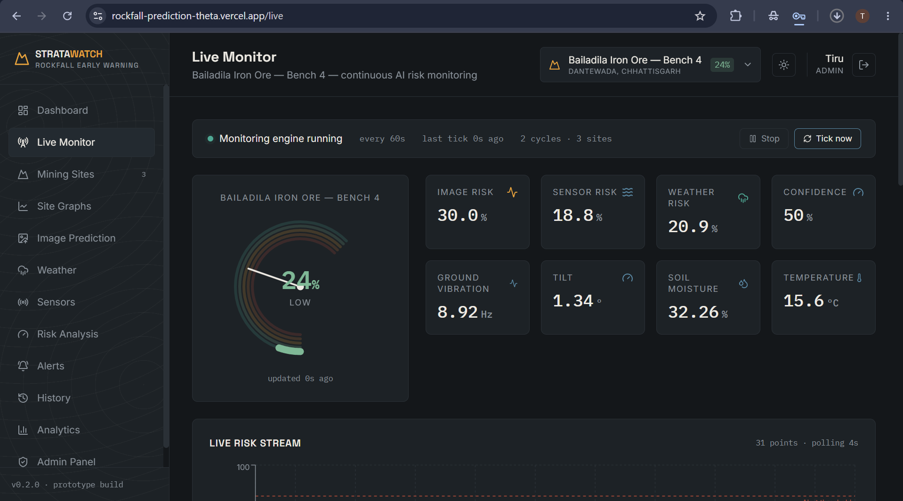
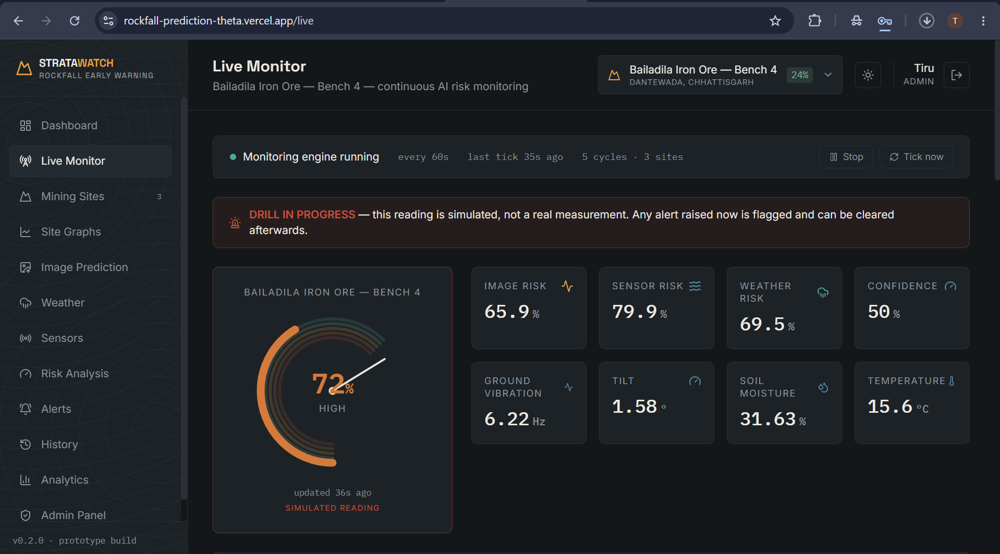
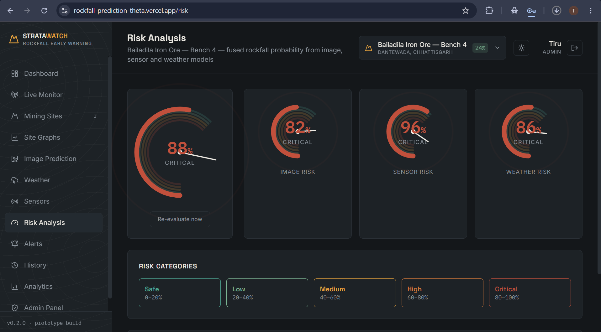
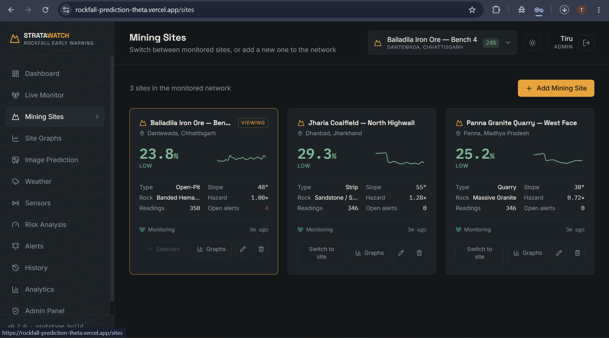
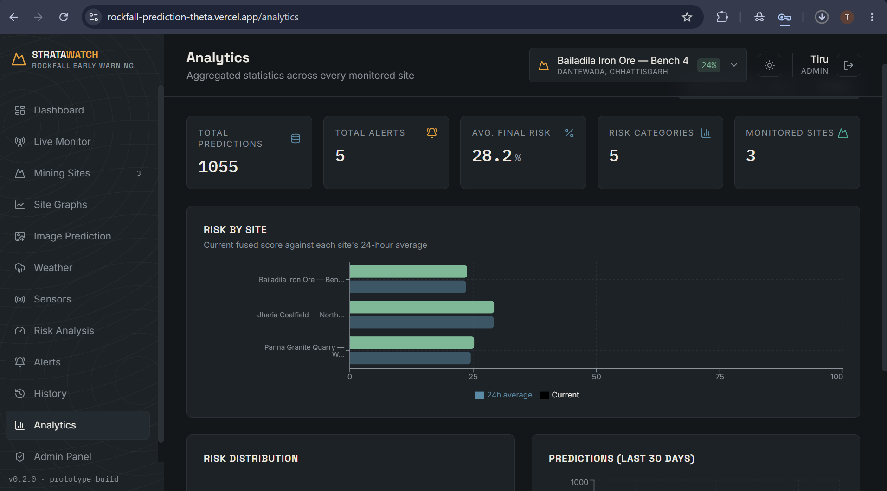
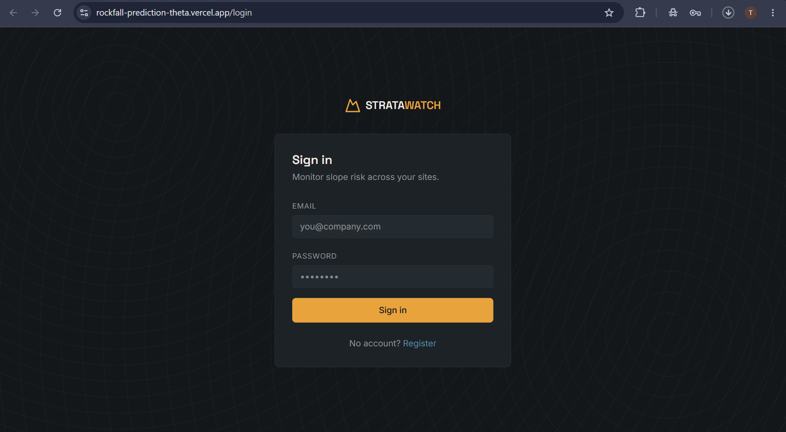
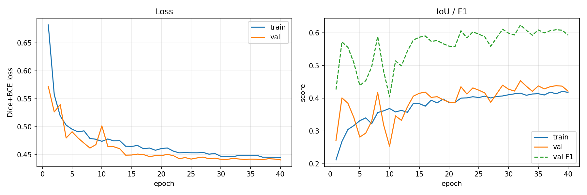

# StrataWatch — AI-Based Rockfall Prediction & Early Warning System

[](https://rockfall-prediction-theta.vercel.app)
[](https://rockfall-api-b5ju.onrender.com/docs)
[](https://rockfall-api-b5ju.onrender.com/api/health)

A working full-stack prototype: FastAPI backend + React (Vite/Tailwind) dashboard
that continuously monitors **multiple mining sites**, fuses image, sensor and
weather signals into a rockfall risk score per site, explains that score with a
statistical insight engine, and ships with auth, alerts, history, per-site
graphs, analytics and an admin panel.

## 🔗 Live deployment

| | Link |
|---|---|
| **Dashboard** | https://rockfall-prediction-theta.vercel.app |
| **API docs (Swagger)** | https://rockfall-api-b5ju.onrender.com/docs |
| **API health** | https://rockfall-api-b5ju.onrender.com/api/health |

Register an account and pick role **Admin** to get the Admin Panel, the
monitoring-engine controls and drill mode. Three demo mining sites are seeded
automatically on first run.

> **Note on first load:** the backend runs on Render's free tier, which sleeps
> after ~15 minutes of inactivity. The first request after a gap can take
> 30–60 seconds while it wakes up. Subsequent requests are fast.

**Read this before assuming any number is "real AI":** this is a genuinely
functional end-to-end app, but two of the three risk signals are built from
**real datasets got from open source like kaggle, USGS Landslide Inventory, etc**, and one is an explicitly-labeled placeholder.
See "What's real vs. simulated" below — it matters for how you present this.

Dataset Links:
(https://www.kaggle.com/datasets/noaa/noaa-severe-weather-data-inventory)
(https://www.usgs.gov/data/landslide-inventories-across-united-states-ver-30-february-2025?utm_source=chatgpt.com)

---

## 📸 Screenshots

### Dashboard — fused risk at a glance
The risk gauge, the three contributing signals and live sensor readings for the
selected site. The banner confirms the background engine is evaluating on its own.



### Live Monitor — continuous monitoring
Engine status, live gauge and the streaming risk chart. Admins can stop the
engine or force an immediate cycle with **Tick now**.



### Alert drill — risk escalating
A drill in progress: risk has climbed to 72% (High) and every component has risen
with it. The banner and the **SIMULATED READING** label make it unmistakable that
this is a drill, not a real measurement.



### Risk Analysis — Critical, with the breakdown
The same drill at full escalation: 88% fused (Critical), decomposed into imagery
82%, sensors 96% and weather 86%, against the five risk bands.



### Mining Sites — switch between sites or add new ones
Each site carries its own geology profile — mine type, rock type, slope angle and
hazard factor — which drives its own sensor simulation, so sites genuinely differ.



### Analytics — across the whole network
Aggregate statistics and current-vs-24-hour-average risk for every monitored site.



### Sign in
Role-based access: Admin, Operator and Guest.



---

## 🖥️ Sample output

Real output captured from a running instance.

**Service health** — `GET /api/health`

```json
{
  "status": "ok",
  "service": "AI Rockfall Prediction & Early Warning System",
  "monitoring": {
    "running": true,
    "interval_seconds": 20,
    "last_tick": "2026-08-09T16:04:02.714064+00:00",
    "tick_count": 18,
    "sites_tracked": 3,
    "last_error": null
  }
}
```

**AI assessment under normal conditions** — `GET /api/monitor/insights/site-a`

```
Bailadila Iron Ore — Bench 4 is at 21.9% fused risk (Low). Slope Imagery is the
dominant driver at 55% of the score (raw 30.0%). The score has held flat across
the last 18 readings. Signal is steady (σ=0.58).

trend    : Stable (-0.064 / reading)
drivers  : Slope Imagery 54.7%  |  Weather 23.8%  |  Geotechnical Sensors 21.4%
```

**Alert drill — escalation to Critical** (4-step ramp to 88%)

```
reading     fused  level     flag
1           38.9%  Low       DRILL
2           55.2%  Medium    DRILL
3           71.5%  High      DRILL
4           87.8%  Critical  DRILL     <- alert threshold (80%) crossed
5           87.8%  Critical  DRILL
```

**AI assessment during the drill** — note how the narrative and actions escalate

```
Bailadila Iron Ore — Bench 4 is at 87.8% fused risk (Critical). Geotechnical
Sensors is the dominant driver at 38% of the score (raw 96.0%). Risk has climbed
+63.0 points over the last 24 readings (+1.94/reading). Signal is erratic
(σ=24.78). Outlier readings detected on: fused risk score.

[CRITICAL] Clear personnel and equipment from the runout zone below this face.
[HIGH]     Notify the geotechnical engineer on duty and log a face inspection.
[HIGH]     Risk is escalating at +1.94%/reading — shorten the monitoring
           interval and brief the incoming shift.
[HIGH]     Fused risk score is above its baseline (87.8% vs 23.45%) — verify
           the instrument before acting on the reading.
[MEDIUM]   Sensor-led risk: cross-check displacement against survey prisms and
           confirm instrument calibration.
```

**Alert raised** — `GET /api/alerts?site_id=site-a`

```
simulated=1  Critical  87.8%  [DRILL] High rockfall risk detected at
                              Bailadila Iron Ore — Bench 4: 87.8% (Critical).
```

Every drill-generated row is flagged `simulated` and prefixed `[DRILL]`, so
demonstration data can never be mistaken for a real incident.

---

## 🧠 Deep learning — landslide segmentation U-Net

A U-Net trained from scratch on **Landslide4Sense** to segment landslide pixels
in Sentinel-2 satellite imagery. This is the one genuinely learned component in
the system; everything else is documented statistics.

| | |
|---|---|
| Architecture | U-Net, 4 down / 4 up with skip connections, **7.8M parameters** |
| Input | 128×128 × **14 channels** — Sentinel-2 B1–B12, slope (B13), DEM (B14) |
| Data | 3,799 labelled patches, split 70/15/15 (seed 42) |
| Training | 40 epochs, Adam lr 1e-3, ReduceLROnPlateau, batch 16, ~40 min on a T4 |
| Loss | Dice + weighted BCE (`pos_weight ≈ 42`) |
| Serving | Exported to ONNX (31 MB), run with ONNX Runtime |

### Results — held-out test split, 569 patches

| Metric | @ 0.5 | **@ 0.9 (tuned)** |
|---|---|---|
| **IoU (Jaccard)** | 0.4555 | **0.5758** |
| **F1 / Dice** | 0.6259 | **0.7308** |
| Precision | 0.4688 | 0.6580 |
| Recall | 0.9415 | 0.8217 |

F1 **0.73** is in line with published Landslide4Sense baselines (0.70–0.75).



### Why accuracy is not reported

This model scores **97.35% pixel accuracy**. Predicting "no landslide"
everywhere scores **97.65%** on the same split.

**The trivial baseline beats the model on accuracy — while detecting nothing at
all.** That is the entire reason this project reports IoU and F1 instead, and
why the loss is Dice-based rather than plain cross-entropy. `evaluate.py` prints
accuracy deliberately, next to the real metrics, so the gap is visible.

### Threshold matters here

`pos_weight ≈ 42` stops the model collapsing to the majority class, but it also
makes it over-predict: at the default 0.5 cut-off recall is 0.94 while precision
is only 0.47. Sweeping the threshold moves IoU from 0.456 to **0.576 at 0.9**,
which is what the served model uses by default.

### Try it

```
GET  /api/landslide/info      model card + the metrics above  (public)
POST /api/landslide/predict   upload a .h5 patch -> mask + pixel fraction
```

Full pipeline, dataset link and Colab notebook: [`training/`](training/) ·
[one-click Colab](https://colab.research.google.com/github/Tiru1505/Rockfall_Prediction/blob/main/training/Landslide4Sense_UNet.ipynb)

## What's real vs. simulated

| Signal | Status | Source |
|---|---|---|
| **Weather risk** | Real | Your `jfk_weather_cleaned.csv` — actual hourly station data (rainfall, humidity, wind, pressure), fed through a documented weighted-risk formula |
| **Seismic index** | Real | Your `global_earthquakes_2020_2026.csv` — real earthquake catalog, used to season the sensor feed |
| **Sensor readings** | Simulated | No IoT hardware connected. Each site keeps its own drifting state, seeded from its geology profile (slope angle, bench height, hazard factor) and nudged by the real seismic index above. Swap `sensor_service.simulate_reading()` for a real MQTT/HTTP ingestion call to go live |
| **Per-site weather** | Real data, shared station | Only one weather station was supplied, so each site reads a deterministic **offset window** of that one real record. Every value shown is a genuine observation, but two sites are reading different hours of the same station — not two stations. See `_site_window()` in `weather_service.py` |
| **Image prediction** | Placeholder | No labeled slope/drone-image dataset was available, so `image_predictor.py` uses real pixel statistics (brightness/contrast) as a stand-in, clearly marked in code and in the API's `gradcam_note` field. Swap in a fine-tuned EfficientNetB0 + Grad-CAM per the docstring in that file |
| **Monitoring AI / insights** | Real statistics, not an LLM | `ai_insights.py` computes OLS trend, driver decomposition, volatility, MAD-based anomaly z-scores and a linear forecast band from each site's own history. The narrative is templated from those numbers, so every sentence traces to a value on screen. It is **not** a language model and not a physical failure model |
| **Live monitoring engine** | Fully real | A background asyncio loop actually evaluates every active site on an interval and persists the results — monitoring continues whether or not a dashboard is open |
| **Landslide catalog** (`catalog.csv`) | Included, unused yet | Copied into `backend/app/data/` — ready to use for labeling/training a real model |
| **Sites, auth, alerts, history, analytics, admin** | Fully real | Backed by SQLite (swap `DATABASE_URL` for Postgres/MongoDB), JWT auth, real CSV export |

This is an honest, demo-ready prototype — not a claim that a trained CNN or live
IoT network is running. That's exactly what's needed to demo the concept and
extend it into a real system.

---

## Multi-site monitoring

The system monitors a **network of mining sites** rather than a single slope.

- **Switch sites** from the dropdown in the top bar (available on every page) or
  from the **Mining Sites** page. The selection persists across reloads and
  scopes the Dashboard, Live Monitor, Sensors, Weather, Risk, Alerts, History
  and Site Graphs pages.
- **Add a site** from *Mining Sites → Add Mining Site*. Beyond name and
  location, a site carries a geology/geometry profile — mine type, rock type,
  bench height, slope angle and a `hazard_factor` multiplier — which seeds that
  site's sensor simulation. A steep highwall in weak interbedded strata reads
  measurably hotter than a shallow massive-granite face.
- **Archive vs. delete.** The UI archives (stops monitoring, hides from the
  switcher, keeps the incident record). Hard deletion with history purge exists
  only on the API (`DELETE /api/sites/{id}?purge=true`) because it can't be undone.
- Three demo sites are seeded on first run. Deleting them all is fine — the app
  handles an empty network and prompts you to add one.

## Live monitoring & the insight engine

A background engine (`monitoring_engine.py`) evaluates every active site every
`ROCKFALL_MONITORING_INTERVAL` seconds (default 20), stores a prediction, and
raises alerts past the threshold. It starts automatically; set
`ROCKFALL_MONITORING_AUTOSTART=0` to require a manual start. Admins can
start/stop it or force a tick from the **Live Monitor** page.

The Live Monitor page shows, per site: a live gauge and streaming risk chart
against the alert threshold, and an **AI Risk Assessment** panel with

- a plain-language narrative of the current state,
- ranked **drivers** (each signal's weighted share of the score),
- **trend** direction with its OLS slope, and signal stability (σ),
- a **6-step forecast** with a √step confidence band,
- **anomaly flags** (modified z-score ≥ 3.5 on any channel),
- **recommended actions** keyed to level, dominant driver and trend,
- estimated readings until the alert threshold, when trending upward,

plus a network overview ranking every site by risk.

## Drill mode — demonstrating the alert path

With no slope image uploaded, `image_risk` sits at its neutral 30 default, so
the fused ceiling is roughly

```
0.40×30 + 0.35×100 + 0.25×~35  ≈  56%
```

The 80% alert threshold is therefore **unreachable from the simulated feed**,
and alerting could never be shown working. Drill mode forces a site to a target
score so the whole escalation path can be demonstrated.

From **Live Monitor → Alert Drill** (admin only): pick a target, choose *ramp*
(risk climbs over N readings, so the trend, forecast and escalating
recommendations are all visible) or *instant*, and start. A 4-step ramp to 88%
produces:

```
reading 1   40.5%  Medium
reading 2   56.3%  Medium
reading 3   72.0%  High
reading 4   87.8%  Critical   <- alert fires, AI escalates to CRITICAL
reading 5   87.8%  Critical   <- holds, then the real feed resumes
```

**Everything a drill produces is marked.** Predictions and alerts carry
`simulated = 1`, alert text is prefixed `[DRILL]`, the CSV export has a
`simulated` column, and the UI badges them in the alert list, history table and
live gauge. A forced alert indistinguishable from a real one would corrupt the
incident record of a safety-warning system, so this is deliberate.

**Clear all drill data** (in the same panel, or
`DELETE /api/monitor/drill-data`) removes every simulated reading and alert
afterwards, leaving only genuine data.

```
GET    /api/monitor/drill              active drills
POST   /api/monitor/drill              start        (admin)
DELETE /api/monitor/drill/{site_id}    cancel       (admin)
DELETE /api/monitor/drill-data         purge        (admin)
```

## Per-site graphs

**Site Graphs** renders one site over a 6h / 24h / 7d / 30d window:
fused risk with all three component signals, geotechnical sensor channels,
weather channels on a dual axis, risk-level distribution, a current
risk-signature radar across all six normalised channels, alerts per hour, and a
cross-site comparison of average vs. peak risk.

---

## Project structure

```
rockfall-system/
├── backend/                 FastAPI app
│   ├── app/
│   │   ├── main.py           entrypoint + monitoring-engine lifespan
│   │   ├── core/              config, DB, JWT security, auth deps,
│   │   │                       bootstrap (migration/seed), UTC time utils
│   │   ├── models/             SQLAlchemy models (incl. MiningSite)
│   │   ├── schemas/            Pydantic request/response schemas
│   │   ├── routers/            auth, sites, monitor, weather, earthquakes,
│   │   │                       sensors, predictions/risk, analytics, admin
│   │   ├── services/           weather/earthquake loaders, per-site sensor
│   │   │                       simulator, image predictor, risk fusion,
│   │   │                       site evaluation, monitoring engine,
│   │   │                       ai_insights (trend/forecast/anomalies)
│   │   └── data/               your 3 CSVs, copied in
│   └── requirements.txt
└── frontend/                 React + Vite + Tailwind v4
    └── src/
        ├── api/               axios client (JWT auto-attached)
        ├── lib/               shared risk palette + time formatting
        ├── context/           Auth + Theme + Site (selected site) providers
        ├── components/        Sidebar, Topbar, SiteSwitcher, ScopeToggle,
        │                       RiskGauge, StatCard, AIInsightPanel
        └── pages/              Dashboard, LiveMonitor, Sites, SiteGraphs,
                                 ImagePrediction, Weather, Sensors, Risk,
                                 Alerts, History, Analytics, Admin,
                                 Login, Register
```

### Key API endpoints added

```
GET    /api/sites                     list sites + live state (switcher)
POST   /api/sites                     add a mining site
PATCH  /api/sites/{id}                edit a site
DELETE /api/sites/{id}[?purge=true]   archive (or hard-delete)
GET    /api/sites/{id}/charts         per-site chart bundle
GET    /api/sites/{id}/compare        cross-site comparison

GET    /api/monitor/status            engine state
POST   /api/monitor/control           start | stop | tick   (admin)
GET    /api/monitor/live              live wall, all sites
GET    /api/monitor/live/{id}         live state + alerts, one site
GET    /api/monitor/insights/{id}     AI analysis for one site
GET    /api/monitor/insights          network roll-up
```

Existing endpoints (`/history`, `/alerts`, `/risk/current`, `/risk/evaluate`,
`/sensors/live`, `/weather/summary`, `/analytics/summary`, the CSV export) now
all accept an optional `site_id` and remain backwards compatible without it.

---

## Running it

### Backend
```bash
cd backend
python3 -m venv venv && source venv/bin/activate
pip install -r requirements.txt
uvicorn app.main:app --reload --port 8123
```
API docs (Swagger) will be at `http://127.0.0.1:8123/docs`.

### Frontend
```bash
cd frontend
npm install
npm run dev
```
Open `http://127.0.0.1:5173`. The dev server proxies `/api/*` to the backend
on port 8123 (see `vite.config.js`) — no CORS setup needed locally.

### First use
Register an account (pick role **admin** to see the Admin Panel and the
monitoring-engine controls), then log in. Three demo mining sites are seeded
automatically and the monitoring engine starts evaluating them immediately —
open **Live Monitor** to watch it, or **Site Graphs** once a few readings have
accumulated. Use the site dropdown in the top bar to switch sites, and
**Mining Sites → Add Mining Site** to add your own.

"Run new evaluation" on the Dashboard or Risk Analysis page still forces an
immediate reading for the selected site; it goes through the same code path as
the engine and is tagged `manual` in History.

An existing `rockfall.db` from before multi-site support is migrated in place on
startup (`core/bootstrap.py`): the new columns are added and old rows are
backfilled from their `site_name`. No data is lost and no manual step is needed.

### Environment variables

| Variable | Default | Purpose |
|---|---|---|
| `ROCKFALL_DATABASE_URL` | local SQLite | Point at Postgres/MySQL for production |
| `ROCKFALL_SECRET_KEY` | dev key | **Change this** before deploying |
| `ROCKFALL_MONITORING_AUTOSTART` | `1` | `0` to require starting the engine manually |
| `ROCKFALL_MONITORING_INTERVAL` | `20` | Seconds between monitoring cycles |

---

## Deploying (Vercel + Render)

The frontend deploys to **Vercel** as a static build; the backend and database
go to **Render**. Config lives in `vercel.json` and `render.yaml`.

### 1. Backend → Render

Dashboard → **New → Blueprint** → point at this repo. `render.yaml` creates the
web service *and* a Postgres database, wires `DATABASE_URL` between them, and
generates `ROCKFALL_SECRET_KEY`.

Deploying manually instead? Use:

| Setting | Value |
|---|---|
| Root directory | `backend` |
| Build command | `pip install -r requirements.txt` |
| Start command | `uvicorn app.main:app --host 0.0.0.0 --port $PORT` |
| Health check | `/api/health` |
| `PYTHON_VERSION` | `3.11.9` |

Then set `ROCKFALL_ENV=production` and a real `ROCKFALL_SECRET_KEY`, and attach
a Postgres instance so `DATABASE_URL` is present.

### 2. Frontend → Vercel

Import the repo and **leave "Root Directory" as the repository root** — do not
set it to `frontend`. `vercel.json` lives at the root and already builds from
`frontend/`; pointing Vercel's root at `frontend/` makes it ignore that file,
and you lose the SPA rewrite below.

`vercel.json` supplies the build command and output directory, and rewrites all
routes to `index.html`. That rewrite is required: the app uses `BrowserRouter`,
so without it a hard refresh on `/live` or `/sites` returns 404.

Add one environment variable, then deploy:

```
VITE_API_BASE_URL = https://<your-render-service>.onrender.com/api
```

Vite **inlines this at build time**, so changing it later needs a redeploy, not
just a restart. Setting the variable and only clicking "Redeploy" sometimes does
not produce a new build — pushing a commit reliably does.

The `/api` suffix is added automatically if you leave it off, and trailing
slashes are stripped, so all of these work:

```
https://your-service.onrender.com
https://your-service.onrender.com/
https://your-service.onrender.com/api
```

### 3. Close the CORS loop

Once Vercel gives you a URL, set it on the Render service and redeploy:

```
ROCKFALL_CORS_ORIGINS = https://<your-project>.vercel.app
```

Leaving it unset falls back to `*`, which works but allows any origin. Preview
deployments get their own URLs, so add them too if you need them to reach the API.

### Things that will bite you on the free tiers

- **Render free services sleep after ~15 minutes idle.** The monitoring engine
  sleeps with them, so gaps appear in history and the first request after
  waking takes ~30–60s. `render.yaml` therefore uses a 60s tick rather than 20s.
- **Render's free Postgres expires after 30 days.** Upgrade or recreate it
  before then or the API loses its database.
- **Do not run production on SQLite.** Render's filesystem is ephemeral: every
  deploy and every spin-down wipes all accounts, sites and readings. The app
  logs a warning at startup if you do this, and refuses to start entirely if
  `ROCKFALL_SECRET_KEY` is still the development default.
- **Cold-start 401s are normal-looking but aren't a bug** — the frontend clears
  the session and redirects to login on any 401.

---

## Design

Visual identity: "StrataWatch" — a geological-instrument console rather than a
generic SaaS dashboard. Dark basalt background, copper/amber/rust risk colors
(evoking rock strata and hazard tape rather than default red/green), Space
Grotesk for headings, IBM Plex Mono for all live data readouts. The signature
element is the radial risk gauge styled as a rock cross-section.

---

## Extending to production

1. **Real image model**: collect/label slope images into
   Stable/Moderate/High/Dangerous, fine-tune EfficientNetB0, replace
   `image_predictor.predict()` — the return shape is already fixed so nothing
   else needs to change. Add real Grad-CAM and return a heatmap image.
2. **Real sensors**: replace `sensor_service.simulate_reading()` with an
   MQTT/HTTP client reading actual accelerometer/tilt/moisture hardware. It
   already takes a `site_id`, so per-site routing is in place.
3. **Real per-site weather**: replace `weather_service._site_window()` with a
   per-site weather API call keyed on each site's stored lat/long (already
   captured on the site form) — the risk formula stays as-is.
4. **Smarter insights**: `ai_insights.analyse()` is the single seam. Swap the
   OLS trend/linear forecast for a trained sequence model, and/or generate the
   narrative with an LLM. The return shape is what the UI renders, so nothing
   else changes.
5. **Scaling the engine**: the monitoring loop evaluates sites serially in one
   worker thread — fine for tens of sites at a 20s interval. For hundreds, move
   it to a task queue (Celery/APScheduler + Redis) so it survives restarts and
   scales past a single process.
6. **Database**: point `ROCKFALL_DATABASE_URL` at Postgres or swap the
   SQLAlchemy layer for MongoDB collections (Users/Predictions/SensorData/
   Alerts/Images/Logs) as originally scoped. Note `core/bootstrap.py` uses
   SQLite-flavoured `ALTER TABLE` for its in-place migration — on Postgres,
   move to Alembic.
7. **Deployment**: containerize each side (Dockerfiles not included in this
   pass — ask if you want them), frontend to Vercel, backend to
   Render/Railway, DB to managed Postgres or MongoDB Atlas.
8. **Docs/report/slides**: not generated in this pass — say the word and I'll
   put together the project report, README-as-submission, and a slide deck
   from what's actually built here (rather than describing features that
   don't exist yet).
